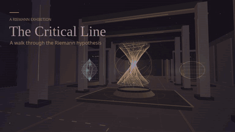

# The Critical Line

[전시관 입장](https://the-critical-line.vercel.app/) · [증명 해설](https://the-critical-line.vercel.app/proof.html) · [English](README.md)

리만가설을 다룬 1인칭 전시다. 영점을 임계선에 놓아 보면서 가설의 내용을 읽고, 소수 거듭제곱에 가중치를 달면서 증명을 따라간다. 왜 세타 리프트를 √x번쯤 잇는지, 소수의 가중합으로 어떻게 선 밖의 영점을 배제하는지를 각 방에서 직접 움직여 볼 수 있다.

[](https://the-critical-line.vercel.app/)

## 관람 조작

- **키보드** - WASD로 걷고, Shift로 달린다. Space는 점프, E는 작품 조작, F는 주먹이다. 빛 조각 일곱 개를 모은 뒤 중앙 작품으로 돌아가 E를 누르면 불이 켜진다. 마우스를 끌어 시점을 바꾸거나 바닥을 눌러 걸어갈 수 있다.
- **터치** - 방향 버튼으로 걷고 화면을 끌어 둘러본다. 가까운 작품을 누르면 체험이 열린다. 중앙 작품은 화면에 뜨는 버튼을 눌러 밝힐 수 있다.
- **전시 지도** - 목적지를 정하고 바닥의 황동 표식을 따라 걷는다. 작품을 열면 정면에서 볼 수 있다. 화면을 끌거나 버튼을 눌러 각도를 돌리고, 작품을 닫으면 열기 전 자리에 돌아온다.

입구 벽의 별 지도는 [제타 함수 영점](https://www.lmfdb.org/zeros/zeta/)에서 양의 허수부 24개와 그 켤레를 가져왔다. 기본 언어는 영어다. 상단의 KO를 누르면 한국어로 바뀐다.

## 증명과 원본

레벤트 알푀게는 [발표 원문](https://alpo.ge/remark.pdf)에서 Claude와 함께 논증을 발전시키고 Lean으로 형식화했다고 밝혔다. [증명 해설](https://the-critical-line.vercel.app/proof.html)은 [Yan Ru Pei가 정리한 증명 구조](https://peabrane.github.io/files/pei-2026-claimed-lean-proof-rh-roadmap.pdf)를 따라 산술적 상한, 구간형 Landau 정리, 함수방정식을 잇고, 각 단계에서 공개 Lean 선언을 열 수 있게 했다.

소수 거듭제곱의 가중합은 브라우저에서 직접 계산한다. 다른 모형은 증명의 한 단계씩을 다룬다. 마지막 방에서는 포함된 [Main.lean](https://github.com/Deicyde/riemann-hypothesis/blob/a172c464fd4bcfc4f53e394dcba45d742b1409a6/src/Main.lean)의 SHA-256 지문을 계산한다. 전체 증명의 검사 결과는 [Lean·Mathlib 공동 성명](https://leanprover-community.github.io/blog/posts/riemann-hypothesis/)과 [앤드루 서덜랜드의 독립 검사 기록](https://math.mit.edu/~drew/grh/)에서 볼 수 있다.

[이 증명이 해결한 것](https://the-critical-line.vercel.app/proof.html#results)에서 두 명제의 범위를 읽고 직접 센 소수 개수와 보장 범위를 비교할 수 있다.

## 로컬 실행

```sh
python3 -m http.server 8000 --bind 127.0.0.1 --directory dist
```

[localhost:8000](http://localhost:8000/)을 연다. Three.js와 WebGL 2로 전시관을 그린다. WebGL 2를 쓸 수 없으면 Canvas 2D로 같은 공간을 그린다.

## 크레딧

[Three.js](https://github.com/mrdoob/three.js)는 [MIT 라이선스](dist/vendor/THREE-LICENSE.txt)를 따른다. 서체는 [Instrument Serif](https://fonts.google.com/specimen/Instrument+Serif)와 [Pretendard](https://github.com/orioncactus/pretendard)에서 필요한 글자를 모은 Gallery Sans를 썼다. [Instrument Serif](dist/fonts/instrument-serif-OFL.txt)와 [Gallery Sans](dist/fonts/gallery-sans-OFL.txt)의 라이선스를 함께 제공한다.
