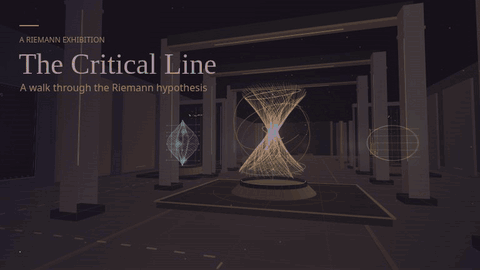

# The Critical Line

[Walk through the exhibition](https://the-critical-line.vercel.app/) · [Read the proof guide](https://the-critical-line.vercel.app/proof.html) · [한국어](README.ko.md)

The Critical Line is a first-person exhibition about the Riemann hypothesis. The route starts with the zeros on the line, then picks up the argument from the other end: weigh prime powers, find the inert primes, and see why the proof needs a chain of about √x theta lifts. The last rooms show how a bound on the prime sum rules out zeros off the line and how independent checkers verified the Lean proof.

[](https://the-critical-line.vercel.app/)

## Walk through

- **Keyboard** - WASD to walk, Shift to run, Space to jump, E to open an installation, and F to punch. Drag to look around or click the floor to walk there.
- **Touch** - Use the movement pad and drag to look around. Tap a nearby installation to open it.
- **Floor plan** - Pick a waypoint and follow the brass trail on foot. Finishing an installation leaves you where you started it.

The atlas on the entrance wall uses the first 24 positive [zeta zero heights](https://www.lmfdb.org/zeros/zeta/) and their reflections. EN is the default. Switch to KO from the top bar.

## The proof

Levent Alpöge’s [announcement](https://alpo.ge/remark.pdf) credits Claude for work on the argument and its Lean formalization. The [proof guide](https://the-critical-line.vercel.app/proof.html) links each step to its declarations in the published code. It follows [Yan Ru Pei’s roadmap](https://peabrane.github.io/files/pei-2026-claimed-lean-proof-rh-roadmap.pdf) to connect the arithmetic estimate, the windowed Landau theorem, and the functional equation.

The prime-power sum is computed in the browser. The other interactive models isolate specific steps. In Proof Relay the browser hashes the bundled [Main.lean](https://github.com/Deicyde/riemann-hypothesis/blob/a172c464fd4bcfc4f53e394dcba45d742b1409a6/src/Main.lean). The [Lean and Mathlib statement](https://leanprover-community.github.io/blog/posts/riemann-hypothesis/) and [Andrew Sutherland’s records](https://math.mit.edu/~drew/grh/) cover the full proof and its independent checks.

## Run locally

```sh
python3 -m http.server 8000 --bind 127.0.0.1 --directory dist
```

Open [localhost:8000](http://localhost:8000/). The hall uses Three.js with WebGL 2 and falls back to Canvas 2D. The site is static.

## Credits

[Three.js](https://github.com/mrdoob/three.js) uses the [MIT license](dist/vendor/THREE-LICENSE.txt). The typefaces are [Instrument Serif](https://fonts.google.com/specimen/Instrument+Serif) and Gallery Sans, a subset of [Pretendard](https://github.com/orioncactus/pretendard). See their [Instrument Serif](dist/fonts/instrument-serif-OFL.txt) and [Gallery Sans](dist/fonts/gallery-sans-OFL.txt) licenses.
